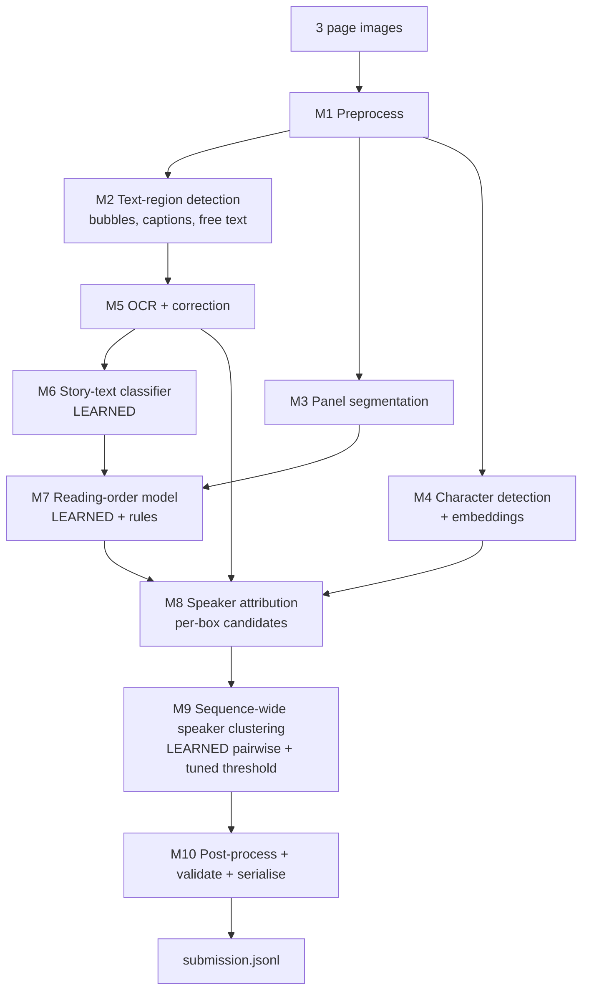

# arch.md — Architecture & Build Specification

**Project:** Manga Transcription + Speaker Attribution (three-page sequences)
**Audience:** an AI coding agent that will build, train, evaluate and package this project, and the human reviewers who will read the result.
**Read order:** `README.md` (rules, overview, definition of done) → this file (full technical spec).

> Every number in section 2 and 3 was measured on the supplied development labels and `score.py`.
> Any number in this document labelled **target** is a goal, not a result. **Never write a target into a results table; only paste numbers produced by your own runs.**

---

## 0. Hard rules (non-negotiable)

| # | Rule | How the build must enforce it |
|---|------|-------------------------------|
| R1 | Only **open-weight models and open-source tools**. | Every model is loaded from local weights (downloaded once from a model hub is fine). No network call at inference time. |
| R2 | **No hosted AI inference APIs** (OpenAI, Anthropic, Google, etc.) to create training targets or test predictions. | Add `tests/test_no_network.py`: runs the full inference path with sockets disabled. Add a grep check in CI for `openai`, `anthropic`, `api.`-style clients. |
| R3 | At least one **learned component adapted with data** from the development set. | See section 7 (weak-label alignment + trained filter / ordering / speaker-link models, optional LoRA). Document what was trained, on what, and the gain over the unadapted baseline. |
| R4 | Test predictions are **generated automatically** from test images. No manual edits, no hand-written test answers, no tuning on test images. | `make predict` is the only path that writes `submission.jsonl`. Test images are touched **only** by the final inference run. All thresholds are tuned on development data. |
| R5 | **Cite everything external** and describe your own contribution. | Maintain `THIRD_PARTY.md` (name, version, licence, URL, what it is used for). Verify licences yourself at build time. |
| R6 | Keep each 3-page **sequence together** in any split. | Split by `sequence_id` (see 7.5). Add a unit test asserting no sequence appears in two folds. |

---

## 1. Task contract

**Input:** three consecutive English manga page images per sequence (`dataset/<split>/images/<sequence_id>/01.png|02.png|03.png`). `sequences.json` lists the triplets and their split.

**Output:** one JSON object per line (`submission.jsonl`):

```json
{"sequence_id":"seq_xxx","pages":[
  [{"speaker":"char1","text":"..."},{"speaker":"char2","text":"..."}],
  [{"speaker":"char1","text":"..."}],
  []
]}
```

Validation performed by `score.py::load_jsonl` (your writer must satisfy all of it):

* exactly keys `sequence_id`, `pages`; `pages` is a list of **exactly 3** lists;
* each line has exactly `speaker` and `text`; both non-empty strings; `speaker` has no leading/trailing whitespace;
* `text` must not be empty after normalisation and must contain no control characters;
* no duplicate JSON keys, no duplicate `sequence_id`;
* no `sequence_id` that is not in the reference file (extras are an error; missing ones score 0).
* An empty page is `[]`.

**What counts as story text**

| Include | Exclude |
|---------|---------|
| Dialogue, inner thoughts (assign to the thinker), narration/caption boxes (`NARRATION`), clear spoken screams/grunts, punctuation-only balloons (`...`, `?!`, `!`) | Visual SFX and their translated captions; tiny unclear breath/reaction text drawn on art; titles, logos, credits, page numbers, ads, watermarks; character-introduction labels; editor/scanlator notes; writing on signs, clothes, objects; text inside letters, diaries, phone screens, newspapers, UIs |

Reading order: usually right-to-left, top-to-bottom per panel row, but follow the actual panel layout and balloon connections. Preserve stutters/repeats/meaningful punctuation. **Do not** preserve printed line wrapping (join wrapped lines with a space).

**Speaker labels:** free-form strings (`char1`, `char2`, …) that must be **consistent across the 3 pages of one sequence**. Labels restart per sequence. The literal string `NARRATION` is reserved for narrator text. Never emit the string `UNKNOWN` (see 3).

---

## 2. Data facts (measured on `development/labels.jsonl`)

| Fact | Value |
|------|-------|
| Development sequences / pages | 80 / 240 |
| Test sequences / pages | 15 / 45 |
| Labelled lines | 1,753 (mean 7.3 per page, max 19) |
| Empty pages | 10 of 240 (≈4%) |
| Mean characters per line | 32 (max 201) |
| Lines that are entirely upper-case | 1,597 (≈91%) — scanlation lettering; case is irrelevant to the scorer |
| `NARRATION` lines | 76 |
| `UNKNOWN` lines (gold identity unresolved) | 34 |
| Distinct speakers per sequence | mean 3.2, min 0, max 8 |
| Image size | PNG, ≈830–990 px wide × 1200–1400 px tall |
| Annotation | **Text + speaker only. There are no boxes, panel masks or character boxes.** |

Observed annotation conventions (from `seq_2032620aa4e4ac7f` page 1 and `seq_a3bd36201a0cd61b`):

* A bold tagline strip on a splash panel is **not** in the gold; the SFX word "SNAP" is **not** in the gold; Japanese lettering on a jersey is **not** in the gold.
* A tiny tilted balloon far from any visible speaker **is** in the gold, with speaker `UNKNOWN`.
* Opening-page caption boxes (school name, setting description) **are** `NARRATION`.
* Reading order within a row of panels followed right-to-left; within a panel, top-right balloon first.
* One speaker can span several consecutive gold lines; line splitting itself is irrelevant to the scorer (see 3).

Because there are no box labels, **box-level supervision must be created automatically** by aligning OCR output to the gold text (section 7.1).

---

## 3. Scorer analysis → design consequences

Derived by reading `score.py` and running sanity experiments on the dev labels:

| Experiment (gold text, perturbed speakers) | `text_order_score` | `balanced_joint_f1` |
|---|---|---|
| Oracle (gold text + gold speakers) | 1.000 | 1.000 |
| Perfect text, **one** label for every non-narration line | 1.000 | **0.304** |
| Perfect text, **every line** its own label | 1.000 | **0.139** |
| Empty submission | 0.000 | 0.000 |

What the metrics actually do:

1. **`text_order_score`** = mean over *active* pages of `1 − Levenshtein(norm(joined page text)) / max(len)`. Speaker is ignored; line boundaries are ignored; order matters at character level; case/whitespace/quote style are normalised away. Pages that are empty in both gold and prediction are excluded from the average (no free points), but invented text on a gold-empty page scores 0 for that page.
   → *Precision matters as much as recall.* Every false SFX or sign-text inclusion costs edit distance. Filtering quality is a first-class goal.
2. **Token alignment** is a monotonic fuzzy alignment per page (tokens ≥3 chars may match at ≥0.6 similarity). Wrong reading order breaks the alignment and hurts both metrics.
3. **`balanced_joint_f1`**: predicted labels are mapped one-to-one to gold labels (Hungarian), then **each gold identity contributes its own F1 equally**, divided by `(#gold speakers + #extra predicted speakers)`.
   → A character who says one line counts as much as the protagonist. Over-splitting adds "extra speakers" to the denominator; merging two characters leaves one gold identity at zero. **Both errors are costly; the clustering threshold must be tuned for this metric**, not for pairwise accuracy.
4. `NARRATION` is a fixed identity (exact spelling); predicted `NARRATION` is only correct against gold `NARRATION`. Mislabelling a narration box as a character is an error twice (lost narration F1, polluted character).
5. Tokens aligned to gold `UNKNOWN` are ignored when counting predicted speakers, so unresolvable lines are cheap — but only if the **text** is still right. Do **not** emit the literal `UNKNOWN` as a speaker (it would be treated as an ordinary label).
6. `speaker_accuracy_on_matched` is inflated when little text is recovered. Report all five macro metrics, and treat `text_order_score` + `balanced_joint_f1` as the primary pair.

**Design consequences**

* Build the pipeline so that **text recovery and ordering are good before speaker work starts** (speaker F1 is bounded by text recovery).
* Make the speaker module's label count explicit and tunable (target the dev-set average of ≈3 characters/sequence as a prior, not a rule).
* Own a **fast proxy scorer** (rapidfuzz-based) for inner loops and tuning; always confirm with the official `score.py` on every reported number. `score.py` uses pure-Python Levenshtein and is slow in tight loops.

---

## 4. System overview



### Capability tiers (build in this order; each tier must work end-to-end before the next starts)

| Tier | Description | Purpose |
|------|-------------|---------|
| **T0 — Baseline** | OpenCV bubble detection + Tesseract + right-to-left sort, one speaker label. CPU only. | Always-valid submission; lower bound for ablations. |
| **T1 — Modular text** | Pretrained text/bubble detector + VLM or Paddle OCR + learned story-text filter + learned reading order. Speakers still heuristic. | Maximises `text_order_score`. |
| **T2 — Speakers** | Character detection/embeddings + tail/proximity + VLM set-of-marks attribution + learned pairwise same-speaker model + tuned clustering. | Maximises `balanced_joint_f1`. |
| **T3 — Stretch** | LoRA fine-tune of a small open VLM for end-to-end per-page transcription (and/or judge component), ensembled with T2. | Optional extra learned component and accuracy bump. |

Each tier writes a valid `submission.jsonl`; keep the best-by-dev-CV one as the final output.

---

## 5. Module specifications

Each module is a Python class with `run(inputs) -> outputs` and a JSON-serialisable result cached under `artifacts/cache/<module>/<sequence_id>/` so that expensive steps (OCR, VLM) are never recomputed during tuning. Cache keys include the module version and config hash.

### M0 — Data & utilities
* `src/data/loader.py`: reads `sequences.json`, `labels.jsonl` (map gold `UNKNOWN → None`, as the scorer does for references), yields `Sequence(id, split, image_paths, gold_pages|None)`.
* `src/eval/proxy_score.py`: fast approximate `text_order_score` / `balanced_joint_f1`; test that it agrees with `score.py` (|Δ| < 0.01) on 20 random perturbed predictions.
* `src/eval/run_official.py`: thin wrapper that calls `score.py` as a library (`score.evaluate`) and writes `scores.json` plus a per-sequence CSV.
* Determinism: global seed in `configs/base.yaml`; log package versions and model hashes to `artifacts/run_manifest.json`.

### M1 — Preprocessing
* Load PNG → RGB; keep original size; produce (a) grayscale, (b) 2× upscaled crops on demand, (c) a resized copy for VLM input (`max_pixels` configurable, default ≈ 1.0–1.3 MP).
* Never crop away margins: page numbers/credits are removed by the classifier, not by cropping.

### M2 — Text-region detection
* **Primary:** a pretrained comic/manga **bubble + text** detector (RT-DETR/YOLO-class; candidates in section 12). Output boxes with class ∈ {`bubble`, `text_bubble`, `text_free`} + confidence. Run at 2 scales and merge by NMS to catch tiny balloons.
* **Fallback / union:** OpenCV approach — threshold, find large near-white connected components with dark text inside (balloons) and rectangular caption boxes; MSER/EAST-style free-text candidates.
* **Punctuation-only balloons:** for any `bubble` whose OCR is empty, extract dark connected components; if a few small components with a bubble-sized white context remain and no letter-like shapes, create a *punctuation candidate* (resolved in M5).
* Output per box: `id, page, bbox, polygon?, det_class, det_conf, parent_bubble_id?`.
* **Diagnostic (must be reported):** *detector token recall* = share of gold tokens that fall inside some detected box (via the weak alignment in 7.1). This is the ceiling of everything downstream.

### M3 — Panel segmentation
* Rule-based first: gutter detection via row/column whitespace projection + connected components of non-white content, recursive XY-cut; produce panel polygons/boxes with row/column structure.
* Optional learned/pretrained panel detector if the detector toolkit provides one.
* Output: ordered-agnostic list of panels; each text box gets `panel_id` (box centre inside; else nearest).

### M4 — Character detection & embeddings
* Detect characters (faces/bodies) with a pretrained manga/anime character detector (candidates in section 12) or VLM grounding as a fallback.
* Crop each detection (face-biased), compute an appearance embedding with a pretrained open vision encoder (DINOv2 / SigLIP / CLIP class). Optionally fine-tune a small projection head with the weak same-speaker labels (7.3).
* Output: `char_id, page, bbox, embedding, det_conf`.
* Manga is grayscale line art: do not use colour features. Hair tone, screen-tone patterns, glasses, hats, and clothing outlines are what matter; multi-crop (face + upper body) embeddings help.

### M5 — OCR + correction
* **Primary OCR:** run a small open VLM or OCR model on each padded, upscaled box crop (candidates: Qwen-VL family, PaddleOCR, Florence-2, Tesseract baseline). Prompt for *verbatim transcription only; join wrapped lines; preserve stutters, punctuation, ellipses*.
* **Ensemble:** run two OCR engines; pick by agreement/char-level confidence; keep the alternative in the cache for the learned filter to use as a feature (disagreement is evidence of non-story text/SFX).
* **Correction (optional, learned thresholds):** a local open LLM may fix OCR errors using page context, **constrained** so the output stays within a normalised edit distance of the OCR text (default ≤ 0.25) — otherwise revert. Never let it add or remove sentences.
* **Normalisation (tune on dev):** unify quotes/ellipsis (`...`), strip artefacts, join line-wrap hyphenation only if dev analysis shows gold joins such cases (check; do not assume), keep `?!`, `!!`, `...`.
* **Punctuation-only resolution:** a tiny classifier (template matching or a small CNN on the crop) decides among `...`, `?`, `!`, `?!`, `!?`, `!!`, `??` or "not text".
* Output: `text_raw, text_alt, ocr_conf, is_punct_only`.

### M6 — Story-text classifier (**learned**)
Goal: decide per box whether it is *included story text* and its **kind** ∈ {`speech`, `thought`, `narration`, `exclude`}.
* **Features:** detector class and confidence; inside-bubble flag; bubble contour smoothness (speech balloons smooth, thought clouds scalloped, SFX spiky or none); box size relative to page and to median text height; rotation angle; stroke thickness and fill (SFX is bold/outlined/large); OCR confidence and engine disagreement; text features (all-caps ratio, length, dictionary-word ratio, onomatopoeia list match, digit-only, URL/credit keywords); page-position features (corners/edges → page numbers/credits); VLM zero-shot yes/no score "is this a speech balloon / caption / SFX / sign?" as a feature.
* **Model:** gradient-boosted trees (LightGBM / sklearn `HistGradientBoosting`) as default; optional small fine-tuned VLM judge on crops.
* **Labels:** produced by weak alignment (7.1): matched to a gold line ⇒ include; unmatched ⇒ exclude; narration vs speech from gold `NARRATION`.
* **Operating point:** choose the probability threshold that maximises dev-CV `text_order_score` (typically slightly precision-leaning), not F1 on boxes.
* **Fallback:** hand-written rules if too few positives in a fold.

### M7 — Reading-order model (**learned + rules**)
* **Baseline rule:** sort panels right-to-left within a row, rows top-to-bottom (configurable `direction`); inside a panel, order balloons by (top-to-bottom bands, then right-to-left), keeping boxes that belong to one balloon chain contiguous.
* **Learned refinement:** pairwise model `P(a before b)` on features (Δx, Δy, same panel, same bubble/connected, relative panel index, tail direction, kind, size). Train on gold order from weak alignment (7.1). Final order = Copeland/score-sum sort, with panel order hard-constrained unless the model is very confident.
* **Page flow:** order is *per page*; page lists correspond to the three image positions.
* **Merge rule:** boxes in the same balloon (or caption box) are merged to one line (join with a space). Different balloons from the same speaker stay separate lines (the scorer does not care, but speaker assignment is easier).
* Report **order accuracy** (Kendall τ on matched boxes) separately from text accuracy.

### M8 — Speaker attribution (per box → candidate characters)
Three independent signals, fused in M9:
1. **Tail/proximity (geometry):** estimate balloon tail direction/point (skeleton of the balloon contour, convexity defect, or the detector's tail output if available); find the character box nearest to the tail tip along that direction, within the panel. Thought clouds use the small bubble trail. Output `char_id` + confidence.
2. **VLM set-of-marks:** render the page with numbered boxes (balloons) and numbered character boxes; ask a small open VLM *"which numbered character is speaking/thinking in balloon k? answer with the number or 'none'"*; parse structured JSON. Request grounding boxes as a second opinion. Cache results.
3. **Discourse/text cues:** vocatives and names ("YODA, …", "OKAWA-SENPAI, …") imply the addressee is **not** the speaker; same balloon ⇒ same speaker; tight alternation inside a panel ⇒ speaker changes; first-person self-reference reuse; caption boxes (rectangular, no tail) ⇒ `NARRATION`.
* Output per box: ranked candidate `char_id`s with scores, plus text-cue features.

### M9 — Sequence-wide speaker clustering (**learned**)
Nodes = included story boxes across all three pages (non-narration). Edge weight = `P(same speaker | features)` from a pairwise model.
* **Pairwise features:** cosine similarity of the attributed characters' embeddings (face and body); same attributed `char_id` (within page); page gap; same panel; same balloon chain; tail/VLM agreement; vocative-exclusion (A addresses a name that B uses for self ⇒ different); alternation prior; both attributed with low confidence flags.
* **Labels:** from gold speakers via 7.1 (same gold speaker ⇒ 1).
* **Clustering:** average-linkage agglomerative clustering with distance threshold `τ`, plus optional `max_clusters` cap (≈8). **Tune `τ` (and the cap) on dev CV to maximise `balanced_joint_f1`**, because the metric penalises over-splitting and merging asymmetrically (section 3).
* **Singleton policy:** unattributed low-confidence boxes are attached to the highest-probability cluster if `p ≥ τ_attach`, otherwise become their own label. Tune `τ_attach` the same way.
* **Narration:** boxes classified `narration` always get `NARRATION` and are excluded from clustering.
* **Label naming:** assign `char1…charN` in order of first appearance across the three pages.
* **Cross-page consistency check:** unit-test that a character present on pages 1 and 3 receives one label on a synthetic example.

### M10 — Post-processing, validation, serialisation
* Collect per page: ordered `{"speaker","text"}` lines; drop empty/whitespace/control-only text; `str.strip()` speakers; guarantee exactly 3 pages.
* Run the **exact** validator from `score.py` (`load_jsonl`) on the output file; fail the build if invalid.
* Write `submission.jsonl` with `ensure_ascii=False`, one object per line, in the same sequence order as `sample_submission.jsonl`.
* Cross-check: every ID in the sample submission is present exactly once.

---

## 6. Intermediate schemas

```jsonc
// artifacts/cache/boxes/<seq>/<page>.json
{
  "page": 1,
  "boxes": [{
    "id": "p1_b07", "bbox": [x0,y0,x1,y1], "det_class": "text_bubble", "det_conf": 0.93,
    "panel_id": "p1_panel3", "text_raw": "...", "text_alt": "...", "ocr_conf": 0.88,
    "is_punct_only": false,
    "story_prob": 0.97, "kind": "speech",           // speech | thought | narration | exclude
    "order_rank": 4, "balloon_id": "p1_bal5",
    "attrib": [{"char_id":"p1_c2","score":0.81,"source":"tail"}],
    "cluster": "char2"
  }]
}
```

```jsonc
// artifacts/weak_labels/<seq>.json   (created by 7.1, used only for training/diagnostics)
{
  "boxes": { "p1_b07": {"gold_page":1,"gold_line":3,"coverage":0.96,"gold_speaker":"character2","gold_rank":3} },
  "unmatched_gold_lines": [ {"page":1,"line":5,"tokens":9} ],
  "detector_token_recall": 0.94
}
```

---

## 7. Learning plan (what is adapted with data)

### 7.1 Weak-label alignment (the harness that makes everything trainable)
Dev labels have text and speakers but **no boxes**, so create box-level labels automatically:

1. Run M2 + M5 on every dev page (cached).
2. For each page, compute a similarity matrix `S[box, gold_line]` = normalised fuzzy overlap using the **same normalisation and tokenisation as `score.py`** (import `norm`, `TOKEN`, `token_match` from it; do not re-implement). Use token-multiset overlap with fuzzy matching, so partial balloons and merged lines still score.
3. Assign each box to its best gold line if `S ≥ 0.6`; allow several boxes → one line and one box → several consecutive lines (split balloons). Boxes below threshold become **negatives** (non-story).
4. Gold line order gives **order labels**; gold speakers give **same-speaker pair labels**; gold `NARRATION` gives the narration label.
5. Report match quality: fraction of gold tokens covered (this is `detector_token_recall` × OCR quality) and fraction of boxes unmatched. Spot-check ≥ 20 pages visually by rendering boxes with assigned gold lines (`scripts/debug_render.py` writes overlays); fix systematic misassignments before training anything.

> This procedure uses only **gold dev labels and local models**, so it complies with R2/R4.

### 7.2 Models trained
| Component | Model | Supervision | Metric to select |
|---|---|---|---|
| Story-text/kind classifier (M6) | LightGBM or sklearn HGB | weak include/exclude + kind | dev-CV `text_order_score` (pipeline-level, not box F1) |
| Reading-order ranker (M7) | pairwise GBM | gold order | Kendall τ + pipeline `text_order_score` |
| Same-speaker model (M9) | pairwise GBM / logistic | gold speaker pairs | dev-CV `balanced_joint_f1` after clustering |
| Appearance projection head (M4, optional) | linear/MLP on frozen embeddings, contrastive loss | pairs from attributed boxes | retrieval AUC + downstream `balanced_joint_f1` |
| Punctuation classifier (M5) | tiny CNN or template matcher | synthetic + dev punctuation balloons | accuracy on dev punctuation balloons |
| **Stretch (T3):** VLM LoRA | open VLM, LoRA r=16–32, per-page image → JSON of `{text, speaker_hint}` lines | gold pages (speaker hints as local labels) | dev-CV `text_order_score` |

### 7.3 Optional LoRA recipe (T3)
* Base: a small open VLM that fits a 16 GB GPU in 4-bit (≈2–8 B parameters; check current releases at build time).
* Data: per page, image → target JSON `{"lines":[{"speaker":"A","text":"..."}]}` with per-page-local labels; the cross-page identity unification is still done by M9 so the model never needs 3 images at once. Augment with scale jitter, mild blur/contrast, small rotations (±2°); **no horizontal flips** (they corrupt reading order).
* Hyperparameters to start: LoRA r=16, α=32, lr 1e-4 cosine, 3–5 epochs, effective batch 8, image `max_pixels` ≈ 1.0 MP, bf16/fp16 as the GPU supports. Early-stop on held-out-fold `text_order_score`.
* Training set is small (240 pages): prefer 5-fold CV for model selection, then one final run on all 80 sequences.

### 7.4 Tuning knobs (all selected on dev CV, never on test)
`det_conf` thresholds, OCR ensemble policy, `story_prob` threshold, ordering tie-break weights, clustering `τ`, `τ_attach`, `max_clusters`, LLM-correction edit-distance cap, hyphen-joining rule. Use a small grid/Optuna search with the proxy scorer, then confirm the top 3 configurations with the official scorer.

### 7.5 Splits
* 5-fold **grouped by `sequence_id`** (80 sequences → 16 per fold); fixed seed; folds saved to `configs/folds.json`.
* Report mean ± std across folds for the macro metrics. Train final models on all 80 for the test run.
* Because the labels are small and sequences from the same series look alike, additionally report a **series-held-out** check if series can be inferred (e.g. by image-embedding clustering of page styles). Mention this as a limitation if not done.

---

## 8. Evaluation & reporting

* **Primary:** `text_order_score`, `balanced_joint_f1` (macro over sequences). **Also report:** `joint_f1`, `matched_token_coverage`, `speaker_accuracy_on_matched`.
* **Mandatory ablation table** (each row = full dev CV with official scorer):
  T0 baseline → +better detector → +OCR engine/ensemble → +learned filter → +learned ordering → +speaker heuristics → +learned pairwise clustering → (+LoRA, if built).
* **Diagnostics:** detector token recall; weak-label match rate; Kendall τ of ordering; false-include / false-exclude rate by kind; speaker confusion at the sequence level (merge vs split counts); per-fold variance.
* **Error analysis:** save the 15 worst dev sequences with overlays (boxes, kept/dropped, order numbers, assigned cluster) to `reports/error_analysis/` and summarise recurring failure modes (stylised fonts, vertical text, overlapping balloons, partial cut-offs, double-page spreads).
* **Sanity checks to run on every change:** empty-page behaviour (precision on the 10 gold-empty pages), narration F1, single-character sequences, sequences with 0 speakers.

---

## 9. Repository layout

```
manga-transcriber/
├── README.md                 # overview + rules + usage (provided)
├── arch.md                   # this spec
├── THIRD_PARTY.md            # every model/tool/dataset: licence, URL, role
├── Makefile                  # setup, cache, train, tune, eval, predict
├── pyproject.toml / requirements.txt
├── configs/
│   ├── base.yaml  tier0.yaml  tier1.yaml  tier2.yaml  tier3.yaml
│   └── folds.json
├── dataset/                  # (unzipped inputs; git-ignored)
│   ├── development/{images,labels.jsonl}
│   ├── test/images
│   ├── sequences.json  sample_submission.jsonl  score.py
├── src/
│   ├── data/loader.py  splits.py
│   ├── vision/{preprocess,detect_text,panels,detect_chars,embed}.py
│   ├── ocr/{engine_tesseract,engine_vlm,engine_paddle,ensemble,correct,punct}.py
│   ├── learn/{weak_align,features,story_clf,order_rank,speaker_pair,lora_train}.py
│   ├── speakers/{tail,vlm_marks,cues,cluster}.py
│   ├── pipeline/{run_sequence,postprocess,write_submission}.py
│   └── eval/{proxy_score,run_official,ablate,error_analysis}.py
├── scripts/{download_models.py,debug_render.py,make_folds.py}
├── tests/                    # unit + integration + no-network + validator tests
├── artifacts/{cache,models,weak_labels,run_manifest.json}   # git-ignored except small models
└── reports/{results.md,ablations.csv,figures/,error_analysis/}
```

### Make targets
```
make setup        # create env, install deps, download open-weight models
make unzip        # unpack dataset zips into dataset/
make cache        # run detector+OCR+VLM on dev (and later test) and cache outputs
make weaklabels   # build alignment-based labels from dev gold
make train        # train M6, M7, M9 (+ optional M4 head / LoRA) with grouped CV
make tune         # grid/Optuna on dev CV with proxy scorer
make eval         # official score.py on dev CV predictions -> reports/
make predict      # generate submission.jsonl for test (final models, no tuning)
make validate     # run score.py's loader on submission.jsonl + ID checks
make test         # unit tests, incl. no-network and split-leakage tests
```

---

## 10. Compute, environment, runtime

* **Detect hardware at startup** and pick a config: GPU ≥ 12 GB → full T2/T3; smaller GPU → 4-bit models and smaller VLMs; CPU only → T0/T1 with Tesseract/Paddle OCR and cached results.
* A free-tier notebook GPU (16 GB class) is sufficient for the whole project: dev + test is only **285 pages**; caching all VLM/OCR output once makes tuning cheap.
* Target budgets (**targets, measure them**): detector+OCR ≤ 20 s/page on GPU; whole test run ≤ 30 min; full dev CV training/tuning ≤ a few hours. Log wall-clock per module in `run_manifest.json`.
* Python 3.10+, PyTorch, Transformers, OpenCV, rapidfuzz, LightGBM/scikit-learn, Pillow, numpy, PyYAML, pytest. Pin versions.
* Memory caution for VLMs: cap `max_pixels`, process one page (or one crop) at a time, release the model between stages if VRAM is tight.

---

## 11. Compliance checklist (agent must tick all before declaring done)

- [x] No hosted inference API anywhere in the code (grep + `tests/test_no_network.py`).
- [x] All models are open-weight; every one listed in `THIRD_PARTY.md` with licence and role. Non-commercial licences noted (acceptable for coursework; state it).
- [x] At least one learned component trained/adapted on dev data; before/after numbers in `reports/ablations.csv`.
- [x] `make predict` is the only producer of `submission.jsonl`; no manual edits; test images are not used for tuning.
- [x] Splits are by sequence; leakage test passes.
- [x] `submission.jsonl` passes `score.py`'s loader and contains exactly the 15 IDs of `sample_submission.jsonl`.
- [x] README results table filled **only** from real runs; target/placeholder values removed.
- [x] Own contribution described (see README section "What is ours").

---

## 12. Candidate components (verify availability, licence and fit at build time)

Model landscape moves quickly; the agent should check the current hub pages before committing. Record the version/commit hash used.

| Role | Candidates | Notes |
|---|---|---|
| Text/bubble detection | Pretrained RT-DETR/YOLO comic bubble+text detectors on public model hubs; `comic-text-detector`-style tools | Check classes (bubble, text, free text). Some detector toolkits are AGPL/GPL: acceptable for an open coursework project, but note it. |
| Manga transcription + speaker/character association | **Magi** line of work (*The Manga Whisperer*, CVPR 2024; *Tails Tell Tales*, 2024/25 follow-ups, and later versions) | Closest published work to this task: character/text/panel detection, text-to-speaker association, character clustering, OCR. Check licence (research/non-commercial likely) and whether it can be run fully locally. Use as a **component or baseline**, and cite it. |
| OCR | Tesseract (baseline), PaddleOCR, Florence-2 OCR, open VLMs (Qwen-VL family or comparable) | VLMs are strongest on stylised lettering; run on crops, upscaled. |
| Scene/speaker VLM | Small open VLM in 4-bit with grounding ability (Qwen-VL family or comparable) | Use set-of-marks prompting; strict JSON output; cache. |
| Appearance embeddings | DINOv2, SigLIP, CLIP-class encoders | Use multi-crop; optional projection head. |
| Gradient boosting | LightGBM / scikit-learn | Fast, works with tiny data. |
| Fast string metrics | rapidfuzz | For the proxy scorer and weak alignment. |
| External data (optional) | Public manga datasets with box annotations (e.g. Manga109 / similar) | Check terms; most are research-only and mainly Japanese text. Only use if licence allows and cite it. Not required. |

---

## 13. Phased build plan with definition of done

| Phase | Deliverable | Acceptance criteria |
|---|---|---|
| **P0 Setup** | repo skeleton, data unzipped, loader, proxy scorer, official scorer wrapper, folds | `make test` green; proxy vs official score differ by less than 0.01; oracle submission scores 1.0 on both primary metrics. |
| **P1 Baseline (T0)** | Tesseract + OpenCV + one label | Valid `submission.jsonl` for test; dev CV numbers recorded in ablation table. |
| **P2 Detection + OCR** | M2, M5 cached for all 285 pages | Detector token recall reported; ≥ 90% of gold tokens covered, or documented reasons and fixes attempted. |
| **P3 Weak labels** | M6/7 labels | Visual spot-check of ≥ 20 pages; match-rate report. |
| **P4 Learned filter + order** | M6, M7 | Dev-CV `text_order_score` clearly above T0; precision on gold-empty pages reported. |
| **P5 Speakers** | M4, M8, M9 | Dev-CV `balanced_joint_f1` above the "one label" reference (0.30 with perfect text); label-count statistics reported per sequence vs gold. |
| **P6 Tuning** | knobs in 7.4 | Official-scorer confirmation of the best 3 configurations; chosen config frozen in `configs/final.yaml`. |
| **P7 (optional) LoRA** | T3 | Ablation row showing gain or documented negative result. |
| **P8 Final run** | `make predict` + `make validate` | Passes validator; run manifest saved; no test-time tuning. |
| **P9 Report** | `reports/results.md`, README results table, error analysis, THIRD_PARTY.md | Compliance checklist (section 11) fully ticked. |

---

## 14. Risks and mitigations

| Risk | Impact | Mitigation |
|---|---|---|
| Detector misses tiny/odd balloons | Lost text and punctuation-only balloons | Multi-scale detection; OpenCV union; punctuation candidate path; report detector recall. |
| SFX / signs leak in as story text | Edit-distance penalty on every page | Learned classifier with VLM zero-shot feature; precision-leaning threshold tuned on pipeline score. |
| Wrong reading order on irregular layouts | Breaks alignment, hurts both metrics | Panel-aware rules + learned pairwise ranker; examine worst-τ pages. |
| Over-splitting / merging speakers | Large `balanced_joint_f1` loss | Tune clustering on the actual metric; cap clusters; attach policy; narration handled separately. |
| Weak labels noisy | Bad training signal | Same normaliser/aligner as the scorer; visual audit; discard low-confidence alignments. |
| Small data (80 sequences) | Overfitting | Low-capacity models (GBM, linear heads), grouped CV, frozen foundation features, strong regularisation. |
| VLM hallucinated text | Invented text lowers score | Verbatim prompts, constrained correction, OCR ensemble agreement, edit-distance guard. |
| VRAM / time limits | Pipeline unrunnable | Hardware-adaptive configs, 4-bit, caching, T0 fallback. |
| Licence issues | Submission concerns | Maintain `THIRD_PARTY.md`; prefer permissive licences; note non-commercial ones. |
| Accidentally using a hosted API or test labels | Disqualification | R2/R4 tests; manifest of models used; no network at inference. |

---

## 15. Appendices

### A. VLM prompt templates (OCR and set-of-marks; edit after dev experiments)
```
OCR crop:
"Transcribe the text in this manga speech balloon exactly as written, in English.
Join wrapped lines into one line. Keep stutters, repeated letters, ellipses and
punctuation. If the image contains only punctuation, output only the punctuation.
If it contains no readable English text, output EMPTY. Output the text only."

Speaker marks:
"The page shows numbered speech balloons (red) and numbered characters (blue).
For each balloon, return JSON: {\"balloon\": k, \"speaker\": m | null, \"kind\": \"speech|thought|narration|sfx|other\"}.
Use null if the speaker is off-panel or unclear. Output a JSON list only."
```

### B. Sequence-level tuning loop (pseudo-code)
```
for config in grid(τ, τ_attach, max_clusters, story_thr):
    preds = pipeline.run(cached_inputs, models_from_fold_training, config)
    f = proxy_score(preds, gold)       # fast
rank configs by 0.5*text_order + 0.5*balanced_joint_f1 (default weighting; report both)
confirm top-3 with official score.py; freeze best
```

### C. Failure triage order
1. Is the text on the page detected at all? (detector recall)
2. Is it read correctly? (OCR CER on matched boxes)
3. Is it correctly included/excluded? (filter precision/recall)
4. Is it in the right order? (Kendall τ)
5. Is the speaker identity consistent? (merge/split counts)
Fix in this order; later stages cannot repair earlier ones.
